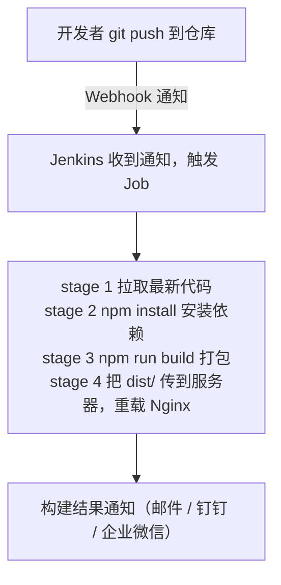

# 01 认识 Jenkins

## 1. Jenkins 是什么？

Jenkins 是一个开源的 **CI/CD（持续集成/持续部署）服务器**。它的工作可以用一句话概括：

> 你把「拉代码 → 安装依赖 → 构建 → 测试 → 部署」这套流程写成脚本交给它，之后每次代码有变动，它自动帮你跑一遍。

没有 CI/CD 之前，部署一个项目是这样的：

```text
本地打包 → 打开 XFTP 上传到服务器 → SSH 登上去解压 → 重启服务 → 祈祷没传错文件
```

有了 Jenkins 之后：

```text
git push → 完事，去喝水
```

## 2. Jenkins 和 GitHub Actions 有什么区别？

如果你用过 GitHub Actions（比如本教程站就是用它自动部署的），会发现两者做的事一模一样。核心区别在「**谁提供跑任务的机器**」：

| 对比项 | GitHub Actions | Jenkins |
|--------|----------------|---------|
| 构建机器 | GitHub 免费提供（云端） | **自己准备**（自己的服务器/内网机器） |
| 安装维护 | 不用装，开箱即用 | 要自己安装、升级、装插件 |
| 配置文件 | `.github/workflows/*.yml` | `Jenkinsfile` |
| 代码仓库 | 基本绑定 GitHub | GitHub / GitLab / Gitee / SVN 都行 |
| 内网项目 | 够不着内网（需自托管 runner） | 天然适合，Jenkins 就装在内网 |
| 典型场景 | 开源项目、个人项目 | **公司内部项目**（代码在内网 GitLab） |

一句话选型：

- 代码在 GitHub 上的个人/开源项目 → 用 GitHub Actions，白嫖构建机器
- 公司内网的项目（GitLab + 内网服务器）→ 用 Jenkins，这也是国内公司的主流配置

所以 Jenkins 值得学：**进了公司大概率躲不开它**。

## 3. 核心概念

Jenkins 的名词不少，先认识最核心的几个，后面章节会反复见到。

### 3.1 Controller 与 Agent（主从架构）

- **Controller（主节点）**：Jenkins 服务本体，提供 Web 界面、管理任务、分派工作
- **Agent（工作节点）**：真正干活（编译、打包）的机器

小团队一台机器身兼两职完全够用（本教程就这么干）；大团队会挂多个 Agent 分担构建压力，比如专门一台机器打安卓包、一台打前端包。

### 3.2 Job / 任务

一个 Job 就是一条「活儿」的定义，比如「构建部署文档站」。Jenkins 里最常用的两种 Job 类型：

- **自由风格（Freestyle）**：在网页上点点选选配置构建步骤。上手快，但配置存在 Jenkins 里，没法跟着代码走，**不推荐**
- **流水线（Pipeline）**：把整个流程写成 `Jenkinsfile` 代码文件，放进代码仓库和项目一起管理。**这是主流，本教程只讲这种**

### 3.3 Jenkinsfile

描述流水线的脚本文件，放在项目根目录，长这样（先眼熟，语法下一章细讲）：

```groovy
pipeline {
    agent any
    stages {
        stage('拉代码')   { steps { checkout scm } }
        stage('构建')     { steps { sh 'npm run build' } }
        stage('部署')     { steps { sh './deploy.sh' } }
    }
}
```

好处和 GitHub Actions 的 yml 一样：**流程即代码**，改流程走代码评审，历史可追溯。

### 3.4 插件（Plugin）

Jenkins 本体很精简，能力全靠插件扩展：Git 拉代码是插件、SSH 部署是插件、钉钉通知也是插件。装 Jenkins 后第一件事就是装一批常用插件（下一章列清单）。

### 3.5 凭据（Credentials）

存放敏感信息的保险柜：Git 仓库的账号密码、服务器的 SSH 私钥、镜像仓库的 token……都存在凭据里，流水线里用 ID 引用，**不允许把密码明文写进 Jenkinsfile**。作用等同于 GitHub Actions 的 Secrets。

### 3.6 触发器（Trigger）

定义「什么时候自动跑」：

- **Webhook**：代码仓库有 push 时主动通知 Jenkins（最及时，主流做法）
- **定时轮询（Poll SCM）**：Jenkins 每隔几分钟去仓库看看有没有新提交（Jenkins 在内网、仓库通知不进来时的替代方案）
- **定时构建（Cron）**：固定时间跑，比如每天凌晨 2 点构建一次

## 4. 一条流水线的完整旅程

以「前端项目自动部署」为例，梳理一遍全流程，建立整体印象：



这条流水线在 Jenkins 里跑起来后，任务详情页会出现 **Stage View**（阶段视图），长这样——每个 stage 一块，全绿代表成功：

```text
┌────────────┬──────────────┬─────────────────┬─────────────┐
│ ✔ 拉取最新代码 │ ✔ npm install │ ✔ npm run build │ ✔ 部署到服务器 │
│   (2.1s)   │   (1m 12s)   │     (45.3s)     │    (8.2s)   │
└────────────┴──────────────┴─────────────────┴─────────────┘
```

哪一步失败，对应格子变红，点进去就能看那一步的日志和耗时。后面写流水线时，你会天天盯着这个页面判断「卡在哪、挂在哪」。

后面的章节就是把这条旅程一步步搭出来：先装 Jenkins（第 2 章），再学 Jenkinsfile 语法（第 3 章），最后分别实战前端、Python、Go 三类项目的部署（第 4~6 章）。

## 动手练习

思考题（本章不用动手装东西）：对照第 2 节的对比表，判断你手头（或公司里）的项目该用 GitHub Actions 还是 Jenkins，写出两条理由。

提示：从「代码仓库在公网还是内网」「构建机器谁出、谁维护」「要不要自己安装升级」三个角度想。

<details><summary>参考分析（三种典型情况）</summary>

- **个人/开源项目，代码在 GitHub** → GitHub Actions。理由：① 构建机器由 GitHub 免费提供，不用自己养一台服务器；② 开箱即用零维护，仓库里放一个 yml 文件就能跑
- **公司项目，代码在内网 GitLab、生产机也在内网** → Jenkins。理由：① GitHub Actions 够不着内网仓库（自托管 runner 也得自己出机器，那不如直接用 Jenkins）；② Jenkins 就装在内网，拉代码、连服务器全程内网闭环，安全可控，也是国内公司的主流配置
- **代码在公网、生产在内网** → 两者皆可：Actions 构建 + SSH 部署进内网，或者用 Jenkins。判断标准回到一句话：**谁提供跑任务的机器更省事，就选谁**

</details>

## 小结

- Jenkins = 装在自己机器上的自动化流水线服务，代码一动自动构建部署
- 和 GitHub Actions 的本质区别：机器自己出、天然适合内网，是国内公司主流
- 核心概念一句话版：**Job 是活儿，Jenkinsfile 是活儿的剧本，Agent 是干活的人，凭据是保险柜，触发器决定啥时候开工**
- 只学 Pipeline（Jenkinsfile）方式，不学自由风格

下一章动手把 Jenkins 装起来：[02-安装Jenkins](02-安装Jenkins.md)
