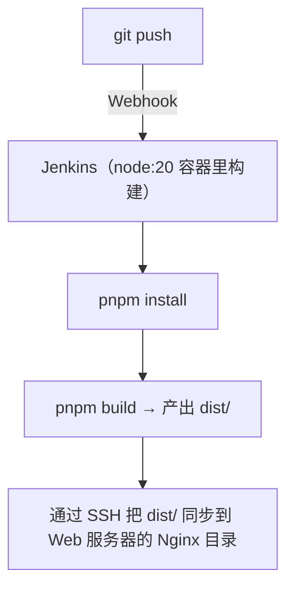

# 04 实战：部署前端项目

第一个完整实战：一个 Vue 3（Vite 构建，产物 `dist/`）项目，push 代码后 Jenkins 自动构建并发布到 Nginx。React、Docusaurus 等只是构建命令和产物目录不同，流程一模一样。

## 1. 整体思路



前端项目的特点是：**产物就是一堆静态文件**，部署 = 把文件放到 Nginx 目录下，不需要重启任何服务。

## 2. 前置条件

- Jenkins 已装好 NodeJS 相关环境（本文用 docker agent，宿主机无需装 Node）
- 凭据 `deploy-server`（SSH 私钥）已配置（见 [02-安装Jenkins](02-安装Jenkins.md) 第 5 节）
- Web 服务器上 Nginx 已就绪，站点目录如 `/var/www/my-app`

## 3. 编写 Jenkinsfile

在前端项目根目录新建 `Jenkinsfile`：

```groovy title="Jenkinsfile"
pipeline {
    agent {
        docker {
            image 'node:20-alpine'
            // 把 pnpm 全局存储挂到宿主机，二次构建不用重新下依赖
            args '-v /opt/jenkins-cache/pnpm:/root/.local/share/pnpm/store'
        }
    }

    options {
        timeout(time: 15, unit: 'MINUTES')
        disableConcurrentBuilds()
        buildDiscarder(logRotator(numToKeepStr: '20'))
    }

    triggers {
        githubPush()
    }

    environment {
        SERVER     = 'root@192.168.1.100'      // 目标服务器
        DEPLOY_DIR = '/var/www/my-app'          // Nginx 站点目录
    }

    stages {
        stage('拉取代码') {
            steps { checkout scm }
        }

        stage('安装依赖') {
            steps {
                sh '''
                    corepack enable            # node:20 自带 corepack，启用后可直接用 pnpm
                    pnpm install --frozen-lockfile
                '''
            }
        }

        stage('构建') {
            steps { sh 'pnpm build' }
        }

        stage('部署') {
            when { branch 'master' }
            steps {
                sshagent(['deploy-server']) {
                    sh '''
                        # 打包上传再解压，比逐个传文件快得多
                        tar czf dist.tar.gz -C dist .
                        ssh -o StrictHostKeyChecking=no $SERVER "mkdir -p $DEPLOY_DIR"
                        scp -o StrictHostKeyChecking=no dist.tar.gz $SERVER:/tmp/
                        ssh -o StrictHostKeyChecking=no $SERVER "
                            find $DEPLOY_DIR -mindepth 1 -delete &&
                            tar xzf /tmp/dist.tar.gz -C $DEPLOY_DIR &&
                            rm /tmp/dist.tar.gz
                        "
                    '''
                }
            }
        }
    }

    post {
        success { echo "部署完成：http://192.168.1.100" }
        failure { echo '构建失败，查看上方日志定位问题' }
        always  { cleanWs() }
    }
}
```

几个值得注意的点：

- **`pnpm install --frozen-lockfile`**：严格按 lock 文件装依赖，CI 标配，防止「本地能跑线上不能跑」
- **先打包再传**：几千个小文件逐个 scp 非常慢，打成一个 tar 包传完再解压
- **`find -mindepth 1 -delete` 只清空目录内容**：不删目录本身。如果这个目录被 Docker 容器挂载着（bind mount），删掉重建会导致容器里看不到新文件
- **npm 用户**把 `corepack enable + pnpm` 换成 `npm ci`、`pnpm build` 换成 `npm run build` 即可

## 4. 服务器上的 Nginx 配置

```nginx title="/etc/nginx/conf.d/my-app.conf"
server {
    listen 80;
    server_name app.example.com;

    root /var/www/my-app;
    index index.html;

    # Vue Router / React Router 的 history 模式必须加这条
    location / {
        try_files $uri $uri/ /index.html;
    }

    # 带 hash 的静态资源缓存一年
    location /assets/ {
        expires 1y;
        add_header Cache-Control "public, immutable";
    }
}
```

改完先执行 `nginx -t` 检查语法，输出 `syntax is ok` 和 `test is successful` 后再 `nginx -s reload` 生效——配置写错了还直接 reload，新配置加载不上，等 Nginx 下次重启更是直接起不来。之后每次 push，流水线跑完页面就更新了，Nginx 不用碰。

## 5. 常见问题

**构建时报 `JavaScript heap out of memory`？**
大项目构建吃内存，在构建命令前加：`export NODE_OPTIONS=--max-old-space-size=4096`。

**pnpm 下载依赖慢？**
docker agent 里加一步换源：`pnpm config set registry https://registry.npmmirror.com`。

**部署后页面还是旧的？**
浏览器缓存了 `index.html`。Nginx 里给 html 加 `add_header Cache-Control "no-cache";`，让浏览器每次校验新鲜度。

## 动手练习

把本文的 Vue + pnpm 流水线改造成 React 版（Vite 脚手架即可）：

1. 先想清楚要动哪几处：agent 镜像要换吗？安装依赖和构建命令改成什么？产物目录是哪个？
2. 改完 push 到 master 触发流水线，确认自动部署成功

<details><summary>参考答案（与 Vue 版的差异点）</summary>

只改两个 stage，其余（tar 打包上传、ssh 部署、post、options）原样不动：

```groovy
stage('安装依赖') {
    steps {
        sh 'npm ci --registry=https://registry.npmmirror.com'
    }
}

stage('构建') {
    steps { sh 'npm run build' }
}
```

- **agent 不用换**：React 和 Vue 一样跑在 `node:20-alpine` 上；不用 pnpm 后，挂 pnpm store 的 `args` 可以去掉（想留缓存就换成 `-v /opt/jenkins-cache/npm:/root/.npm`）
- **产物目录不用换**：Vite 的 React 项目产物同样是 `dist/`，部署那段零修改
- **最容易踩的坑**：`npm ci` 要求 `package-lock.json` 已提交且与 `package.json` 一致，否则报 `npm ci can only install with an existing package-lock.json`——把 lock 文件提交进仓库即可

</details>

## 小结

- 前端部署的本质：构建出静态文件 → 放进 Nginx 目录，无需重启服务
- 用 `node:20-alpine` docker agent，宿主机不装 Node；挂缓存卷加速二次构建
- CI 装依赖用 `npm ci` / `pnpm install --frozen-lockfile`
- 传输用 tar 打包，清空目录用 `find -mindepth 1 -delete`
- history 路由记得配 `try_files`

下一战是需要「重启服务」的后端项目：[05-部署Python项目](05-部署Python项目.md)
