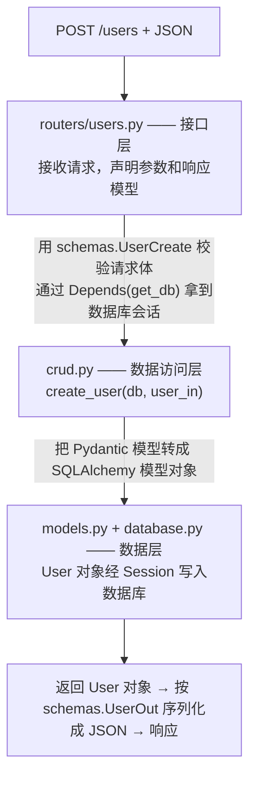

# 4.1 项目结构设计

从本章开始，我们把前面学的所有知识组装起来，开发一个完整的**博客 API** 项目，功能包括：

- 用户管理：注册、查询、修改、删除
- 文章管理：发布、查询、修改、删除（关联作者）
- 标签管理：文章打标签（多对多）
- 列表功能：分页、搜索、排序
- （第五部分再加上：登录鉴权、测试、部署）

## 1. 为什么不能都写在 main.py 里？

前面练习时我们把所有代码塞在一个 `main.py`。项目一大这就是灾难：几千行的文件没法维护，模型、校验、路由、业务逻辑搅在一起，改一处怕碰坏另一处。

专业的做法是**按职责拆分文件**。

## 2. 项目结构总览

在你的项目目录下建立如下结构（本部分会逐个文件写出来）：

```
blog-api/
├── venv/                  # 虚拟环境（不提交 git）
├── requirements.txt       # 依赖清单
├── blog.db                # SQLite 数据库文件（运行后生成）
└── app/                   # 应用主包
    ├── __init__.py        # 空文件，声明这是一个 Python 包
    ├── main.py            # 应用入口：创建 app、挂载路由
    ├── database.py        # 数据库：engine、SessionLocal、get_db 依赖
    ├── models.py          # SQLAlchemy 模型（数据库表结构）
    ├── schemas.py         # Pydantic 模型（接口的输入输出结构）
    ├── crud.py            # 数据库操作函数（业务与 SQL 的隔离层）
    └── routers/           # 路由（接口定义），按资源分文件
        ├── __init__.py
        ├── users.py       # /users 相关接口
        └── posts.py       # /posts 相关接口
```

## 3. 各文件的职责与数据流

一次「创建用户」请求的完整旅程：



各层职责一句话：

| 文件 | 职责 | 一句话 |
|------|------|--------|
| `models.py` | SQLAlchemy 模型 | 数据库里长什么样 |
| `schemas.py` | Pydantic 模型 | 接口收/发的 JSON 长什么样 |
| `crud.py` | 数据库操作 | 怎么查、怎么存 |
| `routers/` | 接口定义 | 有哪些 URL，各自的参数和响应 |
| `database.py` | 连接配置 | 连哪个库、怎么拿 Session |
| `main.py` | 组装 | 把上面的东西拼成一个应用 |

### 新手最容易混淆的一点：models vs schemas

两者都叫「模型」，但完全是两码事：

- **models.py（SQLAlchemy）**：描述**数据库表**。有主键、外键、索引。
- **schemas.py（Pydantic）**：描述**API 的 JSON**。有校验规则、字段过滤（比如不返回密码）。

为什么不合成一个？因为它们天然不一致：数据库存密码哈希，API 绝不返回它；API 创建时不传 id，数据库必有 id。分开定义，各管各的。

> 有个叫 SQLModel 的库尝试把两者合一，感兴趣可以以后了解。教学上分开写更能理解本质。

## 4. 关于路由拆分：APIRouter

之前接口都注册在 `app` 上（`@app.get(...)`）。拆分文件后，每个路由文件用 `APIRouter` 创建一个「小 app」，最后统一挂到主 app 上：

```python
# routers/users.py（最小可运行版，下一章接上数据库）
from fastapi import APIRouter

router = APIRouter(prefix="/users", tags=["用户"])

@router.get("")          # 实际路径 = prefix + "" = /users
def list_users():
    return []            # 先返回空列表，让骨架能跑起来

@router.get("/{user_id}")   # 实际路径 = /users/{user_id}
def get_user(user_id: int):
    return {"id": user_id, "username": "placeholder"}
```

```python
# routers/posts.py（main.py 要挂载它，也给个最小版）
from fastapi import APIRouter

router = APIRouter(prefix="/posts", tags=["文章"])

@router.get("")
def list_posts():
    return []
```

```python
# main.py
from fastapi import FastAPI
from app.routers import posts, users

app = FastAPI()
app.include_router(users.router)
app.include_router(posts.router)
```

- `prefix="/users"`：该文件所有接口自动加上 `/users` 前缀，不用每个接口重复写
- `tags=["用户"]`：`/docs` 里会按 tag 分组展示，文档更清晰

按第 5 节搭好骨架后，把上面三个文件的内容填进去，运行 `fastapi dev app/main.py`，打开 http://127.0.0.1:8000/docs ——接口不再是一长串，而是按 tags 分成「用户」「文章」两组；此时 `GET /users` 返回 `[]`，`GET /users/1` 返回 `{"id": 1, "username": "placeholder"}`。骨架先通水，下一章再把真数据接上。

## 5. 动手：搭好骨架

```bash
mkdir blog-api
cd blog-api
python -m venv venv
# 激活虚拟环境（见 01-入门准备/02）
pip install "fastapi[standard]" sqlalchemy
pip freeze > requirements.txt

mkdir app
mkdir app/routers
```

创建空的包标记文件 `app/__init__.py` 和 `app/routers/__init__.py`（内容为空即可）。

> **`__init__.py` 是干嘛的？** 它告诉 Python「这个文件夹是一个包」，这样才能 `from app import models` 这样导入。留空即可。

骨架搭好后，从下一章开始逐个填充文件。

## 6. 运行方式说明

因为代码在 `app` 包里，启动命令在**项目根目录**（blog-api/）执行：

```bash
fastapi dev app/main.py
# 或
uvicorn app.main:app --reload
```

## 7. 练习

### 练习 1：自建 tags 路由（动手）

仿照 users.py 的最小版，新建 `app/routers/tags.py`（prefix 为 `/tags`、tag 名为「标签」、一个返回空列表的 GET 接口），并挂载到 main.py。验证：重启后 /docs 出现「标签」分组。

<details>
<summary>参考答案</summary>

```python
# app/routers/tags.py
from fastapi import APIRouter

router = APIRouter(prefix="/tags", tags=["标签"])


@router.get("")
def list_tags():
    return []
```

main.py 改动两处：

```python
from app.routers import posts, tags, users   # 导入处加 tags

app.include_router(users.router)
app.include_router(posts.router)
app.include_router(tags.router)              # 新增挂载
```

重启后在 /docs 左侧看到「标签」分组，`GET /tags` 返回 `[]` 即成功。第 4.4 章的练习会给它接上真数据。

</details>

### 练习 2：如果要加「评论」功能（思考）

不写代码，回答：给博客加「文章评论」功能，需要**新建/修改**哪些文件？每个文件各改什么？

<details>
<summary>参考答案</summary>

- **修改 `models.py`**：新增 Comment 模型（id、content、created_at、post 外键，通常还加作者外键）
- **修改 `schemas.py`**：新增 CommentOut；若要在文章响应里带评论，给 PostOut 加 `comments: list[CommentOut]`（注意只往一个方向嵌套，避免循环引用）
- **修改 `crud.py`**：新增 create_comment、list_comments（记得 selectinload）等函数
- **修改 `routers/posts.py`**：评论从属于文章，用 REST 嵌套路径加接口，如 `POST /posts/{post_id}/comments`、`GET /posts/{post_id}/comments`
- **`main.py` 不用动**：接口挂在已有的 posts.router 上；只有当你决定单独建 `routers/comments.py` 时才需要再挂载
- **数据库**：学习期删掉 blog.db 重启重建；正式项目用 Alembic 迁移

这就是分层结构的价值：加一个功能 = 在每一层各加一小块，不碰其他部分；出了问题，也能按数据流（router → crud → models）快速定位到该看哪个文件。

</details>

## 本章小结

- 按职责拆分：models（表）、schemas（JSON）、crud（数据库操作）、routers（接口）、database（连接）、main（组装）
- SQLAlchemy 模型和 Pydantic 模型是两码事，必须分开
- `APIRouter` + `include_router` 实现路由文件拆分
- 记住数据流：router → crud → models/database → 原路返回

下一章：[4.2 数据库会话与依赖注入](02-数据库会话与依赖注入.md) —— 写 database.py 和 models.py。
