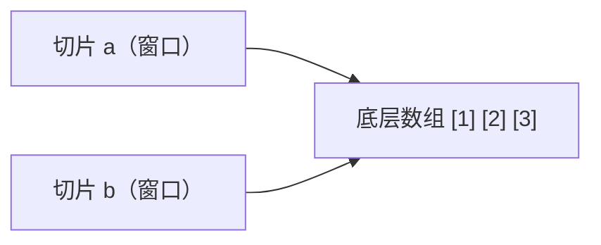

# 3.1 数组与切片

> 本节目标：了解数组（定长），重点掌握切片（slice）——Go 中使用频率最高的数据结构。

## 一、从一个问题开始：存全班 40 个成绩

用第二章的知识，你只能这样写：

```go
score1 := 90
score2 := 85
score3 := 77
// ……还要写 37 个。算平均分呢？score1 + score2 + …… + score40？
```

显然不行。我们需要**把一串数据装进一个变量**的类型。Go 给了两个：**数组**（定长）和**切片**（变长）。实际开发 95% 用切片，但切片建立在数组之上，所以先花五分钟看数组。

## 二、数组：定长的序列

### 拆解一下声明

```
var arr [3]int
         ↑ ↑
        长度 —— 一旦声明，长度永远是 3，加不了减不了
           元素类型 —— 数组里只能装同一种类型
```

读作：**声明一个长度为 3 的 int 数组**。声明后元素全是零值（int 是 0）：

```go
var arr [3]int      // [0 0 0]
arr[0] = 10         // 下标从 0 开始
arr[1] = 20

nums := [3]int{1, 2, 3}         // 声明的同时初始化
auto := [...]int{1, 2, 3, 4}    // [...] 让编译器自己数：len(auto) == 4

fmt.Println(len(arr))           // 3
fmt.Println(nums)               // [1 2 3]
```

### 数组的两个特点（也是它不常用的原因）

**特点 1：长度是类型的一部分。** `[3]int` 和 `[4]int` 是两种不同的类型——函数收 `[3]int`，你传 `[4]int` 编译器直接报错。长度不同，就是不同的东西。

**特点 2：赋值会复制整个数组。**

```go
a := [3]int{1, 2, 3}
b := a          // b 是 a 的完整拷贝，两块独立内存
b[0] = 100
fmt.Println(a)  // [1 2 3] —— a 没变
```

数组了解到这就够了，**记住这两个特点**，马上和切片对比时反差极大。

## 三、切片：可变长的序列（本节主角）

### 声明和数组只差一个"长度"

```
var s []int        ← [] 里不写长度，就是切片
var a [3]int       ← [] 里写了长度，就是数组
```

| 写法 | 结果 | 说明 |
|------|------|------|
| `var s []int` | nil 切片，长度 0 | "还没有内容的空切片" |
| `s := []int{1, 2, 3}` | `[1 2 3]` | 最常用 |
| `s := make([]int, 3)` | `[0 0 0]` | 长度 3，元素全是零值 |
| `s := make([]int, 0, 10)` | `[]` | 长度 0，容量 10（预留空间，见 7.4） |

```go
nums := []int{1, 2, 3}
names := []string{"张三", "李四"}

m := make([]int, 3)             // [0 0 0]
fmt.Println(len(m), cap(m))     // 3 3
```

> 💡 nil 切片可以直接 append：`var s []int` 之后不用任何初始化，直接 `s = append(s, 1)` 就行。这是 Go"零值可用"哲学的又一次出现。

## 四、基本操作：访问、修改、遍历

| 操作 | 语法 | 说明 |
|------|------|------|
| 访问 | `s[i]` | 下标从 0 开始 |
| 修改 | `s[i] = v` | |
| 长度 | `len(s)` | 元素个数 |
| 容量 | `cap(s)` | 底层数组能容纳的个数（见 七） |
| 遍历 | `for i, v := range s` | i 是下标，v 是元素副本 |
| 判空 | `len(s) == 0` | 别用 `s == nil` |

```go
nums := []int{10, 20, 30}

fmt.Println(nums[0])    // 10
nums[1] = 200           // 修改
fmt.Println(len(nums))  // 3

for i, v := range nums {           // 2.4 的 for range
    fmt.Println(i, v)              // 0 10 / 1 200 / 2 30
}
```

> ⚠️ **下标越界不是编译错误，是运行时崩溃**：`nums[5]` 会当场 panic（`index out of range [5] with length 3`）。访问前确保 `i < len(nums)`——配合 2.3 的短路求值：`if i < len(nums) && nums[i] > 0` 就是标准防越界姿势。

## 五、append：追加元素（切片每天用得最多的操作）

### 拆解一下

```
s = append(s, 2, 3)
↑
必须接收返回值 —— append 返回"加好之后的新切片"，不赋回去就丢了
```

各部分含义：

| 部分 | 含义 |
|------|------|
| `append` | 往切片末尾追加元素的函数 |
| 第一个参数 `s` | 原切片 |
| 后面的参数 `2, 3` | 要追加的元素，可以写多个 |

```go
var s []int
s = append(s, 1)        // [1]
s = append(s, 2, 3)     // [1 2 3]

other := []int{4, 5}
s = append(s, other...) // [1 2 3 4 5]，追加整个切片要 ... 展开（和 2.5 的可变参数一样）
```

> ⚠️ **本节头号大坑：append 的结果必须赋回去。**
>
> ```go
> append(s, 6)        // ❌ 编译报错：append(...) evaluated but not used
> s = append(s, 6)    // ✅
> ```
>
> append 不修改原切片，而是**返回新切片**。好在编译器会当场拦住，不至于悄悄出错。

## 六、切一段：s[开始:结束]

"切片"这名字就来自这个操作——从已有切片里切出一段：

```
s[1:4]
  ↑ ↑
  ↑ 结束下标 —— 不包含！取到 3 为止
  开始下标 —— 包含
```

规则：**含头不含尾（左闭右开）**，`s[a:b]` 切出来的长度就是 b−a。

```go
s := []int{0, 1, 2, 3, 4, 5}

fmt.Println(s[1:4])    // [1 2 3]   下标 1、2、3，不含 4
fmt.Println(s[:3])     // [0 1 2]   省略开始 = 从头
fmt.Println(s[3:])     // [3 4 5]   省略结束 = 到尾
fmt.Println(s[:])      // [0 1 2 3 4 5]
```

切出来的这段和原切片**共享**同一份数据——为什么？看下一节。

## 七、切片的本质：底层数组上的一扇窗（全节最重要）

先看一个现象。数组赋值是复制（见 2.3），切片赋值却是——

```go
a := []int{1, 2, 3}
b := a              // 注意：没有复制数据
b[0] = 100
fmt.Println(a)      // [100 2 3] —— a 也变了！
```

这不是 bug，是切片的本质决定的：**切片本身不装数据**，它只是三个字段的小结构——指针（指向底层数组）+ 长度 len + 容量 cap。可以把切片想象成**开在底层数组上的一扇窗**：



`b := a` 复制的是窗口（三个字段），不是数组本身。透过 b 改数据，透过 a 当然也看得见。子切片同理：

```go
s := []int{1, 2, 3, 4, 5}
sub := s[1:3]       // [2 3]，窗口对准了原数组的中段
sub[0] = 999
fmt.Println(s)      // [1 999 3 4 5] —— 原切片跟着变
```

### 想要真正独立的副本：copy

```
copy(目标, 来源)
     ↑   ↑
         被复制的数据
     先开好的新切片 —— 参数顺序：目标在前，来源在后
```

```go
a := []int{1, 2, 3}
b := make([]int, len(a))   // 先开好同样大小的新房
copy(b, a)                 // 把 a 的内容搬进去
b[0] = 100
fmt.Println(a)             // [1 2 3] —— 互不影响
```

> 💡 容量与扩容：append 超出容量时，Go 会分配一个更大的新数组并把数据搬过去——这时新旧切片就"分家"了。新手阶段记两条实用结论即可：
> 1. **切片赋值/传参共享数据**，要独立副本用 `copy`
> 2. **append 结果必须赋回原变量**（"分家"也正是这条规则的深层原因）

## 八、二维切片

切片的元素也可以是切片，表格、棋盘就用它：

```go
grid := [][]int{
    {1, 2, 3},
    {4, 5, 6},
}
fmt.Println(grid[1][2])   // 6（第 2 行第 3 列）
```

## 九、常用操作速查

| 需求 | 写法 |
|------|------|
| 判空 | `len(s) == 0` |
| 追加 | `s = append(s, x)` |
| 删除下标 i 的元素 | `s = append(s[:i], s[i+1:]...)` |
| 求和 | `for _, v := range s { total += v }` |
| 排序（就地修改） | `slices.Sort(s)` |
| 是否包含 | `slices.Contains(s, x)` |
| 最值 | `slices.Max(s)` / `slices.Min(s)` |

> 排序、查找、最值用标准库 `slices` 包（Go 1.21+）：`import "slices"`。

## 新手常见坑

| 现象 | 原因 | 解决 |
|------|------|------|
| `panic: index out of range [5] with length 3` | 下标越界，运行时崩溃 | 访问前判 `len` |
| `append(...) evaluated but not used` | append 结果没接收 | 写 `s = append(s, x)` |
| `cannot use a (variable of type [3]int) as [4]int` | 数组长度是类型的一部分 | 长度不同的数组不能互相赋值 |
| 改了 b，a 跟着变 | 切片赋值共享底层数组 | 独立副本用 `copy` |
| `s[1:4]` 只有 3 个元素 | 左闭右开 | 长度 = 结束 − 开始 |

## 练习

**1. 动手**：创建空 int 切片，循环 append 1~10，打印切片和长度。

**2. 动手**：给定 `s := []int{5, 3, 8, 1, 9}`，手写循环找最大最小值，再用 `slices.Max/Min` 验证。

**3. 猜输出**：先别运行，猜猜打印什么？为什么？

```go
a := []int{1, 2, 3}
b := a[:2]
b[0] = 99
fmt.Println(a)

c := make([]int, len(a))
copy(c, a)
c[1] = -1
fmt.Println(a)
```

**4. 修 bug**：下面的函数想收集切片里的偶数，但结果永远是空的，找出原因：

```go
func evens(nums []int) []int {
    result := []int{}
    for _, n := range nums {
        if n%2 == 0 {
            append(result, n)
        }
    }
    return result
}
```

**5. 挑战**：写函数 `reverse(s []int) []int` 返回**逆序的新切片**（要求不改动原切片——想想该用什么防共享）。

<details>
<summary>点击查看答案</summary>

```go
// 1
var s []int
for i := 1; i <= 10; i++ {
    s = append(s, i)
}
fmt.Println(s, len(s))   // [1 2 3 4 5 6 7 8 9 10] 10

// 2
s := []int{5, 3, 8, 1, 9}
min, max := s[0], s[0]
for _, v := range s {
    if v < min {
        min = v
    }
    if v > max {
        max = v
    }
}
fmt.Println(min, max)    // 1 9
```

**3. 输出：**

```
[99 2 3]    ← b 是 a 上的窗口，共享底层数组，改 b[0] 就是改 a[0]
[99 2 3]    ← c 是 copy 出来的独立副本，改 c 不影响 a
```

**4.** `append(result, n)` 的返回值没有接收——编译器会报 `append(...) evaluated but not used`。改成：

```go
result = append(result, n)
```

```go
// 5
func reverse(s []int) []int {
    result := make([]int, len(s))
    for i, v := range s {
        result[len(s)-1-i] = v   // 直接写新切片，不碰原切片
    }
    return result
}
```

</details>

## 本节小结

- 数组定长、赋值复制、长度属于类型——了解即可，实战用切片
- 切片声明 `[]` 里不写长度；四种创建：nil、字面量、`make([]T, len)`、`make([]T, len, cap)`
- `append` 追加（**结果必须赋回去**）、`s[a:b]` 左闭右开切段、`copy(dst, src)` 复制
- **切片是底层数组上的一扇窗**：赋值/切段共享数据，独立副本用 `copy`
- 下标越界是运行时 panic，访问前判 `len`
- 排序查找用标准库 `slices` 包

下一节：[3.2 map 映射](02-maps.md)
