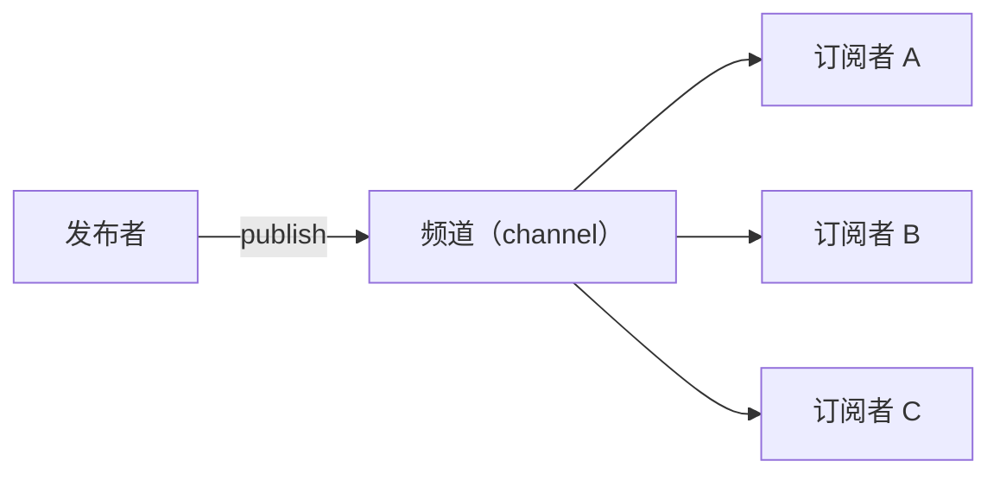

# 3.4 发布订阅（Pub/Sub）

> 发布订阅是 Redis 的"广播电台"功能：发布者往频道里喊一嗓子，所有订阅了该频道的客户端同时收到。
> 本章内容简单，10 分钟学完。

## 1. 模型



- **频道（channel）** 不需要预先创建，发布/订阅时自动存在
- 一条消息会被**所有**订阅者收到（对比 List 队列：一条消息只能被一个消费者抢到）
- 消息**不存储**：发布时不在线的订阅者永远收不到这条消息（像广播，错过就是错过）

## 2. 动手体验（需要开两个终端）

**终端 1（订阅者）**：

```
127.0.0.1:6379> subscribe news
Reading messages... (press Ctrl-C to quit)
1) "subscribe"
2) "news"
3) (integer) 1
（进入等待状态...）
```

**终端 2（发布者）**：

```
127.0.0.1:6379> publish news "Redis 7 发布了！"
(integer) 1        # 返回值 = 收到消息的订阅者数量
```

回到终端 1，会看到消息实时到达：

```
1) "message"
2) "news"
3) "Redis 7 发布了！"
```

## 3. 模式订阅：用通配符一次订阅一批频道

```
# 订阅所有 news. 开头的频道
127.0.0.1:6379> psubscribe news.*

# 另一个终端发布
127.0.0.1:6379> publish news.sports "比赛开始"
127.0.0.1:6379> publish news.tech "新手机发布"
# 两条都能收到
```

订阅端收到的**完整输出**长这样：

```
127.0.0.1:6379> psubscribe news.*
Reading messages... (press Ctrl-C to quit)
1) "psubscribe"
2) "news.*"
3) (integer) 1
1) "pmessage"          ← 注意：是 pmessage，不是 message！
2) "news.*"            ← 第 2 行是匹配到的模式
3) "news.sports"       ← 第 3 行才是真正的频道名
4) "比赛开始"           ← 第 4 行是内容
1) "pmessage"
2) "news.*"
3) "news.tech"
4) "新手机发布"
```

**新手最容易在这里栽跟头**：普通订阅（`subscribe`）收到的 `message` 是 3 行——类型、频道、内容；模式订阅（`psubscribe`）收到的 `pmessage` 是 **4 行**，多了一行"匹配的模式"，频道名也从第 2 行挪到了第 3 行。用代码解析消息时如果按 3 行的格式写死，模式订阅就会取错字段。

## 4. 命令小结

| 命令 | 作用 |
|------|------|
| `subscribe ch1 [ch2 ...]` | 订阅频道 |
| `publish ch message` | 向频道发布消息 |
| `psubscribe news.*` | 按模式（通配符）订阅 |
| `unsubscribe` / `punsubscribe` | 取消订阅 |
| `pubsub channels` | 查看当前有订阅者的频道 |

## 5. 适用场景与局限

**适合**：

- 实时通知：配置变更广播、缓存失效通知（通知所有服务节点清理本地缓存）
- 简单的聊天室、弹幕原型
- 系统内部的轻量事件广播

**局限（重要）**：

- **消息不持久化**：订阅者掉线期间的消息全部丢失
- **没有 ACK**：不保证消息被处理
- 订阅者处理太慢时消息可能被丢弃

一句话定位：**Pub/Sub 适合"丢了也无所谓"的实时通知**。需要可靠投递就用 Stream 或专业消息队列。

> 💡 补充：Redis 有个实用功能叫"键空间通知（keyspace notification）"，可以在 key 过期时向 `__keyevent@0__:expired` 频道发消息，常被用来做"订单 30 分钟未支付自动取消"的简易方案（需在配置中开启 `notify-keyspace-events Ex`）。了解即可。

## 6. 实战例子：配置变更广播

§5 说 Pub/Sub 适合"配置变更广播"，现在用代码完整实现一遍这个真实业务。

**业务背景**：运营后台修改了一次配置（比如商品限购数量），线上 3 台应用服务器各自在内存里缓存了旧配置，要求它们尽快重新加载。

**设计思路**：Pub/Sub 的消息**不存储**，所以配置内容（版本号）用 String 存，频道消息只当"敲门信号"——就算某台服务器掉线错过了通知，重启后主动读存储也能拿到最新值，不依赖消息重放。

发布端 `publish_config.py`（运营后台修改配置后执行）：

```python
import redis

r = redis.Redis(decode_responses=True)

# 1. 先把最新配置版本写进存储
r.set("config:version", "v20261024-01")

# 2. 再广播"配置变了"的信号；返回值 = 收到信号的节点数
receivers = r.publish("config:changed", "reload")
print(f"已通知 {receivers} 个节点重新加载配置")
```

订阅端 `config_watcher.py`（每台应用服务器常驻运行）：

```python
import redis

r = redis.Redis(decode_responses=True)

ps = r.pubsub()
ps.subscribe("config:changed")
print("正在监听配置变更...")

for msg in ps.listen():
    if msg["type"] != "message":     # 跳过订阅确认等控制消息
        continue
    version = r.get("config:version")          # 收到信号后读最新版本
    print(f"收到变更信号，重新加载配置 {version}")
    # 实际业务：按 version 拉取新配置、刷新本地缓存、失效本地锁……
```

运行效果——先启动订阅端，再运行发布端：

```
# 订阅端（每台服务器各一个）
正在监听配置变更...
收到变更信号，重新加载配置 v20261024-01

# 发布端
已通知 1 个节点重新加载配置
```

这就是"丢了也无所谓"的正确打开方式：**通知走 Pub/Sub，数据走存储**。信号丢了不要紧，节点重启后 `get config:version` 一对比版本号就知道该重新加载了。

## 7. 动手练习

1. 开两个终端，完成一次最基本的发布订阅
2. 再开第三个终端也订阅同一频道，验证"一条消息所有订阅者都收到"
3. 关闭订阅者终端，发布一条消息，再重新订阅——验证消息确实收不到了（不存储）

<details>
<summary>参考答案</summary>

第 1 题：终端 1 执行 `subscribe news` 进入等待；终端 2 执行 `publish news hello` 返回 `(integer) 1`（1 个订阅者收到）；终端 1 实时打印出三行：`"message"`、`"news"`、`"hello"`。

第 2 题：再开终端 3 也 `subscribe news`，此时终端 2 再 `publish news hi`，回显变成 `(integer) 2`（订阅者数量翻倍）；终端 1 和终端 3 **同时**各打印一条相同的 `message`——这就是"广播"与 List 队列"一条消息只能被一个消费者抢走"的区别。

第 3 题：关掉终端 1 和终端 3，终端 2 执行 `publish news offline-test`，回显 `(integer) 0`（没有任何订阅者收到）；重新 `subscribe news` 后，之前那条 `offline-test` 永远不会出现——消息不存储，错过就是错过。这也是第 6 节实战例子里"版本号必须落存储、通知只当信号"的原因。

</details>

---

核心机制篇完结！接下来学以致用，写代码 👉 [4.1 用代码操作 Redis](../04-实战篇/01-用代码操作Redis.md)
