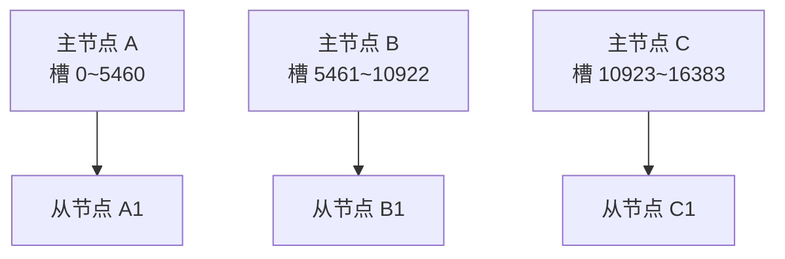

# 5.3 集群 Cluster

> 主从 + 哨兵解决了高可用，但所有数据仍要塞进一台机器的内存。数据量到几十 GB、上百 GB 怎么办？
> **Redis Cluster：把数据切成片，分摊到多台主节点上。** 本章理解概念即可。

## 1. 集群解决什么问题

| 方案 | 高可用 | 读扩展 | 写扩展 | 容量扩展 |
|------|:---:|:---:|:---:|:---:|
| 单机 | ❌ | ❌ | ❌ | ❌ |
| 主从 | ❌ | ✅ | ❌ | ❌ |
| 主从+哨兵 | ✅ | ✅ | ❌ | ❌ |
| **集群** | ✅ | ✅ | ✅ | ✅ |

集群 = **分片（sharding）+ 内置主从故障转移**，一步到位。

## 2. 核心概念：16384 个哈希槽（slot）

集群把整个数据空间划分为 **16384 个槽位**，每个主节点负责其中一段：



**一个 key 归谁管？** 公式：

```
slot = CRC16(key) % 16384
```

对 key 做 CRC16 哈希再取模，落到哪个槽，就存到负责那个槽的节点上。

**扩容怎么办？** 加一台新主节点，把一部分槽（连同槽里的数据）**迁移**给它即可，其他槽不受影响。这就是用"槽"做中间层的妙处：迁移的单位是槽，而不是重新哈希所有 key。

**高可用？** 每个主节点配 1 个以上从节点。某主节点挂了，集群内部自动投票把它的从节点提升为主（无需哨兵，集群自带这套机制）。

## 3. 客户端怎么找到正确的节点

集群模式下客户端可以连任意节点。如果 key 不归这个节点管，节点会返回 `MOVED` 重定向：

```
127.0.0.1:7001> get user:1
(error) MOVED 10778 127.0.0.1:7002    # 告诉你：槽 10778 归 7002 管，去它那儿找
```

实际开发中不用操心——**智能客户端**（ioredis、redis-py-cluster、Lettuce 等）会缓存"槽 → 节点"的映射表，直接把命令发到正确节点。

```python
from redis.cluster import RedisCluster

rc = RedisCluster(host="127.0.0.1", port=7001)
rc.set("user:1", "张三")     # 客户端自动路由到正确节点
```

## 4. 集群的限制（重要，容易踩坑)

分片带来一些代价：

1. **多 key 命令受限**：`mget k1 k2 k3`、`sinter s1 s2` 等涉及多个 key 的命令，要求这些 key 必须在**同一个槽**，否则报错
2. **解决办法——哈希标签（hash tag）**：key 里用 `{}` 包住一部分，计算槽时只看括号里的内容：

   ```
   user:{1001}:profile   # 只对 "1001" 算槽
   user:{1001}:cart      # 同样对 "1001" 算槽 → 两个 key 必然同槽
   ```

3. **只支持 0 号数据库**，`select` 不可用
4. **事务和 Lua 脚本**也要求涉及的 key 在同一槽

## 5. 快速搭一个体验集群（可选实验）

最少 3 主 3 从共 6 个节点。本机体验：

```bash
# 起 6 个节点（端口 7001~7006，每个都开 cluster-enabled）
for port in 7001 7002 7003 7004 7005 7006; do
  redis-server --port $port --cluster-enabled yes \
    --cluster-config-file nodes-$port.conf --daemonize yes
done

# 一条命令组建集群：3 主 3 从
redis-cli --cluster create 127.0.0.1:7001 127.0.0.1:7002 127.0.0.1:7003 \
  127.0.0.1:7004 127.0.0.1:7005 127.0.0.1:7006 --cluster-replicas 1

# 连接时加 -c（cluster 模式，自动跟随 MOVED 跳转）
redis-cli -c -p 7001

# 先查槽号：hello 是 866，落在 7001 自己负责的 0~5460 段内
127.0.0.1:7001> cluster keyslot hello
(integer) 866
127.0.0.1:7001> set hello world
OK
# key 归当前节点管 → 直接返回 OK，不会出现 Redirected

# 换一个归其他节点管的 key 才能看到跳转：user:1 是 10778，落在 7002 的 5461~10922 段
127.0.0.1:7001> cluster keyslot user:1
(integer) 10778
127.0.0.1:7001> set user:1 张三
-> Redirected to slot [10778] located at 127.0.0.1:7002
OK
127.0.0.1:7002>
# 自动跳到 7002 完成写入，提示符也跟着变了（不加 -c 则直接报 (error) MOVED 10778 ...）

# 查看集群状态
127.0.0.1:7001> cluster info
127.0.0.1:7001> cluster nodes
```

## 6. 我的项目该用哪种架构？

新手决策树：

```
数据量 < 10GB？
 ├─ 是 → 能容忍短暂不可用（个人项目/内部系统）？
 │        ├─ 是 → 单机 + 持久化，够了
 │        └─ 否 → 主从 + 哨兵（或云厂商的高可用版 Redis）
 └─ 否（几十 GB 以上 / 写 QPS 单机扛不住）→ 集群
```

> 💡 实际工作中，多数公司直接买云厂商的 Redis（阿里云/腾讯云/AWS ElastiCache），高可用和集群都是勾选项，不用自己搭。但**原理必须懂**——面试考的就是这些。

## 7. 思考题

1. 集群下 `mget user:{1001}:a user:{1001}:b` 能正常执行吗？为什么？把大括号去掉会发生什么？
2. 为什么集群最少要 3 个主节点，2 个不行吗？

<details><summary>参考答案（第 1 题）</summary>

能。因为有哈希标签 `{}`：这两个 key 的槽号都只由括号里的 `1001` 计算，`CRC16("1001") % 16384 = 15391`，槽相同 → 必然落在同一个节点，`mget` 一次就能执行。

去掉大括号后，槽号改由完整 key 计算：`user:1001:a` → 10293，`user:1001:b` → 6230，两个槽不同（即使碰巧在同一个节点上也不行），Redis 直接报错：

```
(error) CROSSSLOT Keys in request don't hash to the same slot
```

想在集群里用多 key 命令，就必须用哈希标签把这些 key"焊"在同一个槽里。
</details>

<details><summary>参考答案（第 2 题）</summary>

因为集群内置的故障转移靠**主节点投票**：某主节点客观下线后，它的从节点要升主，必须获得**超过半数的主节点**同意（和哨兵的 quorum 是同一思想，防止网络分区时脑裂、误切换）。

只有 1~2 个主节点时凑不出多数派：2 主挂 1 个，只剩 1 票，1/2 不过半，故障转移永远完不成，集群一直处于不可写状态。3 主时挂 1 个还剩 2 票，2/3 过半，切换能正常进行。这就是"最少 3 主、每主配 1 从（即 3 主 3 从）"的由来。
</details>

## 8. 小结

- 集群 = 分片存储 + 自带故障转移，同时解决容量、写性能、高可用
- 核心机制：**16384 个槽**，`CRC16(key) % 16384` 决定归属；扩容按槽迁移
- 多 key 操作要求同槽，用**哈希标签 `{...}`** 控制
- 最小生产配置 3 主 3 从
- 选型：小数据量用主从+哨兵，大数据量/高写入才上集群

---

下一章：进阶篇收官——避坑与优化 👉 [5.4 性能优化与最佳实践](04-性能优化与最佳实践.md)
