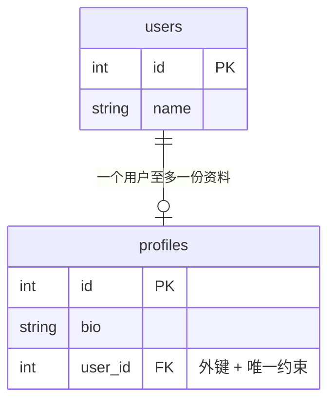

# 4.2 一对一关系

> 一对一其实是"戴了紧箍咒的一对多"。本节很短，重点是搞懂两处不同：`unique=True` 和 `Mapped["X"]`（不带 list）。

## 一、什么时候用一对一？

一个用户只有一份"详细资料"（简介、生日、头像等）。为什么不直接把这些字段放 users 表里？常见理由：

- **主表瘦身**：users 表频繁查询（登录、列表页），把低频的大字段拆出去，主表更快
- **信息分级**：敏感信息（实名、身份证号）单独一张表，方便单独控制权限
- **可选信息**：很多用户根本没填资料，拆表避免主表一堆 NULL



示例数据——`user_id` 加了唯一约束，每个用户最多只能有一行资料：

| users.id | name |     | profiles.id | bio | user_id |
|----------|------|-----|-------------|-----|---------|
| 1 | 张三 |     | 1 | 后端工程师 | **1** |
| 2 | 李四 |     | 2 | 设计师 | **2** |

## 二、实现：外键 + unique + 单数类型注解

```python
from typing import Optional
from sqlalchemy import ForeignKey, String
from sqlalchemy.orm import DeclarativeBase, Mapped, mapped_column, relationship


class Base(DeclarativeBase):
    pass


class User(Base):
    __tablename__ = "users"

    id: Mapped[int] = mapped_column(primary_key=True)
    name: Mapped[str] = mapped_column(String(50))

    # 注意：Mapped["Profile"] 不是 list —— 一对一！
    profile: Mapped[Optional["Profile"]] = relationship(
        back_populates="user",
        cascade="all, delete-orphan",
    )


class Profile(Base):
    __tablename__ = "profiles"

    id: Mapped[int] = mapped_column(primary_key=True)
    bio: Mapped[Optional[str]] = mapped_column(String(500))
    birthday: Mapped[Optional[str]] = mapped_column(String(10))

    # unique=True 是一对一的关键：一个 user_id 只能出现一次
    user_id: Mapped[int] = mapped_column(ForeignKey("users.id"), unique=True)

    user: Mapped["User"] = relationship(back_populates="profile")
```

和一对多相比只有两处不同：

| | 一对多 | 一对一 |
|--|-------|--------|
| 外键列 | `ForeignKey("users.id")` | `ForeignKey("users.id")`, **`unique=True`** |
| "一"方的类型注解 | `Mapped[list["Post"]]` | `Mapped[Optional["Profile"]]` |

原理：

- **`unique=True`** 从数据库层面保证一个用户最多只有一份资料（想插第二份直接报 IntegrityError）
- **`Mapped[Optional["Profile"]]`**（单数、可空）让 SQLAlchemy 知道这侧是"一个对象"而非"列表"——`user.profile` 返回 Profile 或 None，而不是 list

> 📌 在 2.0 里，类型注解写成单数就足以让 SQLAlchemy 识别为一对一，不再需要老教程里的 `uselist=False` 参数（写了也不算错）。

## 三、使用

本章还没创建过 engine 和 SessionLocal——沿用 4.1 的初始化三行（数据库文件换成 one2one.db，模型就用上面定义的 User / Profile）：

```python
from sqlalchemy import create_engine
from sqlalchemy.orm import sessionmaker

engine = create_engine("sqlite:///one2one.db", echo=True)
SessionLocal = sessionmaker(bind=engine)
Base.metadata.create_all(engine)
```

```python
with SessionLocal() as session:
    # 创建用户和资料
    user = User(name="张三")
    user.profile = Profile(bio="后端工程师，SQLAlchemy 爱好者", birthday="1999-01-01")
    session.add(user)
    session.commit()

    # 正向访问
    print(user.profile.bio)        # 后端工程师，SQLAlchemy 爱好者

    # 反向访问
    profile = session.get(Profile, 1)
    print(profile.user.name)       # 张三

    # 没资料的用户
    lisi = User(name="李四")
    session.add(lisi)
    session.commit()
    print(lisi.profile)            # None ← 所以类型是 Optional

    # 替换资料：因为配了 delete-orphan，旧资料自动删除
    user.profile = Profile(bio="全栈工程师")
    session.commit()
```

## 四、查询

```python
from sqlalchemy import select

# 查有资料的用户
stmt = select(User).where(User.profile.has())

# 查简介里带"工程师"的用户
stmt = select(User).where(User.profile.has(Profile.bio.contains("工程师")))
```

> 💡 记忆：关系是列表（一对多）用 `.any(条件)`；关系是单个对象（一对一/多对一）用 `.has(条件)`。

## 🎯 练习

> 前置：跑过第三节"使用"的示例（张三有资料、李四没有），模型和初始化三行存为 `models.py`。

**练习 1：给李四补一份资料**

给没填资料的李四补一份 Profile（简介、生日随意），然后打印 `lisi.profile.bio` 验证。

<details><summary>参考答案</summary>

```python
from sqlalchemy import select
from models import Profile, SessionLocal, User

with SessionLocal() as session:
    lisi = session.scalar(select(User).where(User.name == "李四"))
    lisi.profile = Profile(bio="设计师，热爱交互", birthday="2000-05-20")
    session.commit()
    print(lisi.profile.bio)
```

预期输出：

```text
设计师，热爱交互
```

通过 relationship 赋值，flush 时 SQLAlchemy 自动把 `lisi.id` 填进 `profiles.user_id`——和一对多的级联保存一个道理。

</details>

**练习 2：找出没填资料的用户**

先插入一个新用户王五（不建资料），然后查出所有还没有 Profile 的用户（提示：`~User.profile.has()`）。

<details><summary>参考答案</summary>

```python
from sqlalchemy import select
from models import SessionLocal, User

with SessionLocal() as session:
    session.add(User(name="王五"))             # 没建资料的新用户
    session.commit()

    stmt = select(User).where(~User.profile.has())
    print([u.name for u in session.scalars(stmt)])
```

预期输出（张三本来就有资料，李四在练习 1 之后也有了）：

```text
['王五']
```

注意方法配套：`profile` 是单数关系（`Mapped[Optional["Profile"]]`），用 `.has()`；它没有 `.any()`——那是列表关系（一对多 / 多对多）的方法。

</details>

**练习 3：预测题——给同一用户插第二份资料**

张三已经有一份 Profile。下面这段代码绕过 relationship、手工插一行 `user_id` 指向张三的资料，会发生什么？先预测，再运行验证。

```python
session.add(Profile(bio="第二份资料", user_id=zhangsan.id))
session.commit()
```

<details><summary>参考答案</summary>

**抛 `IntegrityError`**。`profiles.user_id` 上有 `unique=True` 约束，一个用户最多一行资料，数据库直接拒绝：

```text
sqlalchemy.exc.IntegrityError: (sqlite3.IntegrityError) UNIQUE constraint failed: profiles.user_id
```

完整的捕获写法：

```python
from sqlalchemy import select
from sqlalchemy.exc import IntegrityError
from models import Profile, SessionLocal, User

with SessionLocal() as session:
    zhangsan = session.scalar(select(User).where(User.name == "张三"))
    session.add(Profile(bio="第二份资料", user_id=zhangsan.id))
    try:
        session.commit()
    except IntegrityError:
        session.rollback()
        print("一个用户只能有一份资料！")
```

预期输出：

```text
一个用户只能有一份资料！
```

追问：那第三节里 `user.profile = Profile(...)` 再赋一次值怎么不报错？——relationship 赋值是"替换"语义：配了 `delete-orphan` 后旧资料先删、新资料再插，库里始终只有一行。`unique=True` 拦的正是这种绕过 relationship 硬塞第二行的写法。

</details>

## 📝 本节小结

- 一对一 = 一对多 + 外键加 `unique=True` + "一"方注解用单数 `Mapped[Optional["X"]]`
- 适用场景：主表瘦身、敏感信息隔离、大量可选字段
- 单对象关系过滤用 `.has()`，列表关系用 `.any()`

下一节是关系篇的重头戏 → [4.3 多对多关系](03-多对多关系.md)
