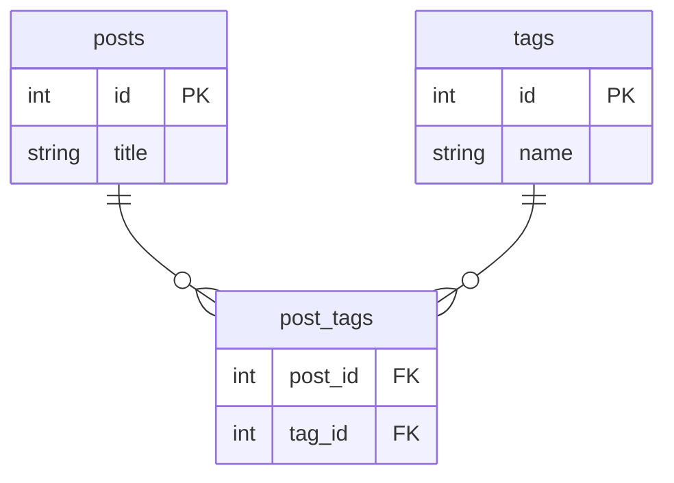

# 4.3 多对多关系

> 一篇文章有多个标签，一个标签也属于多篇文章——这就是多对多。它需要引入一个新角色：**中间表（关联表）**。

## 一、为什么需要中间表？

多对多没法靠一个外键解决：外键放 posts 表？一篇文章只能存一个 tag_id。放 tags 表？同理。

答案：**单独建一张中间表，每行记录一个"配对"**：



示例数据——中间表每行就是一个「配对」：

| posts.id | title |     | post_id | tag_id |     | tags.id | name |
|----------|-------|-----|---------|--------|-----|---------|--------|
| 1 | 文章A |     | 1 | 1 |     | 1 | Python |
| 2 | 文章B |     | 1 | 2 |     | 2 | 数据库 |
|   |       |     | 2 | 2 |     | 3 | 随笔 |

含义：文章A 有 [Python, 数据库] 两个标签；文章B 有 [数据库] 标签。

中间表的每一行 = 一条"某文章拥有某标签"的记录。两列合起来做主键，天然防止同一配对重复插入。

## 二、SQLAlchemy 实现

中间表通常没有业务字段，不需要为它建模型类，用轻量的 `Table` 对象定义即可：

```python
from sqlalchemy import Column, ForeignKey, String, Table, create_engine
from sqlalchemy.orm import (DeclarativeBase, Mapped, mapped_column,
                            relationship, sessionmaker)


class Base(DeclarativeBase):
    pass


# ---------- 中间表：纯 Table 对象，不是模型类 ----------
post_tags = Table(
    "post_tags",
    Base.metadata,
    Column("post_id", ForeignKey("posts.id"), primary_key=True),
    Column("tag_id", ForeignKey("tags.id"), primary_key=True),
)


class Post(Base):
    __tablename__ = "posts"

    id: Mapped[int] = mapped_column(primary_key=True)
    title: Mapped[str] = mapped_column(String(200))

    tags: Mapped[list["Tag"]] = relationship(
        secondary=post_tags,            # ← 关键：告诉 SQLAlchemy 走哪张中间表
        back_populates="posts",
    )

    def __repr__(self) -> str:
        return f"Post(id={self.id}, title={self.title!r})"


class Tag(Base):
    __tablename__ = "tags"

    id: Mapped[int] = mapped_column(primary_key=True)
    name: Mapped[str] = mapped_column(String(50), unique=True)

    posts: Mapped[list["Post"]] = relationship(
        secondary=post_tags,
        back_populates="tags",
    )

    def __repr__(self) -> str:
        return f"Tag(id={self.id}, name={self.name!r})"


engine = create_engine("sqlite:///m2m.db", echo=True)
SessionLocal = sessionmaker(bind=engine)
Base.metadata.create_all(engine)
```

要点：

- 中间表用 `Table(...)` 定义，挂在 `Base.metadata` 上，两个外键列**共同组成主键**
- 两侧 relationship 都写 **`secondary=post_tags`**，都是 `Mapped[list[...]]`
- **你几乎永远不用直接操作中间表**——SQLAlchemy 全自动维护它

## 三、使用：像操作列表一样

### 添加关联

```python
with SessionLocal() as session:
    python_tag = Tag(name="Python")
    db_tag = Tag(name="数据库")
    essay_tag = Tag(name="随笔")

    post_a = Post(title="SQLAlchemy 入门")
    post_a.tags.append(python_tag)       # 就是普通的列表操作！
    post_a.tags.append(db_tag)

    post_b = Post(title="MySQL 调优笔记", tags=[db_tag])   # 创建时直接传

    session.add_all([post_a, post_b])
    session.commit()
```

commit 时 SQLAlchemy 自动往 `post_tags` 里插了 3 行配对记录，全程无感。

### 读取

```python
with SessionLocal() as session:
    post = session.get(Post, 1)
    print([t.name for t in post.tags])       # ['Python', '数据库']

    tag = session.scalar(select(Tag).where(Tag.name == "数据库"))
    print([p.title for p in tag.posts])      # ['SQLAlchemy 入门', 'MySQL 调优笔记']
```

### 解除 / 修改关联

```python
with SessionLocal() as session:
    post = session.get(Post, 1)
    tag = session.scalar(select(Tag).where(Tag.name == "Python"))

    post.tags.remove(tag)     # 只删除中间表的配对记录，Post 和 Tag 本体都还在！
    session.commit()

    # 整体替换标签
    post.tags = [session.scalar(select(Tag).where(Tag.name == "随笔"))]
    session.commit()
```

> 📌 **多对多的删除语义**：`post.tags.remove(tag)` 或 `session.delete(post)` 都只影响**中间表**的配对记录，不会误删 Tag 本体。这也是为什么**多对多关系不要配 `delete-orphan`**（标签是共享的，不从属于任何一篇文章）。

## 四、查询

```python
from sqlalchemy import select

# 查带"数据库"标签的所有文章
stmt = select(Post).where(Post.tags.any(Tag.name == "数据库"))

# 查没有任何标签的文章
stmt = select(Post).where(~Post.tags.any())

# join 写法（跨中间表 join，SQLAlchemy 自动处理两次 JOIN）
stmt = select(Post).join(Post.tags).where(Tag.name == "数据库")
```

## 五、进阶预告：中间表需要额外字段怎么办？

如果配对本身有业务数据——比如"学生选课"要记录**成绩**和**选课时间**：

| student_id | course_id | score | enrolled_at |
|-----------|-----------|-------|-------------|

这时 `secondary` 方式就不够了，需要把中间表升级为**正式模型类**（关联对象模式，Association Object）：把多对多拆成两个一对多（Student 1—N Enrollment N—1 Course）。

```python
class Enrollment(Base):
    __tablename__ = "enrollments"

    student_id: Mapped[int] = mapped_column(ForeignKey("students.id"), primary_key=True)
    course_id: Mapped[int] = mapped_column(ForeignKey("courses.id"), primary_key=True)
    score: Mapped[Optional[int]]

    student: Mapped["Student"] = relationship(back_populates="enrollments")
    course: Mapped["Course"] = relationship(back_populates="enrollments")
```

先知道有这个模式即可，需要时再深入。

## 六、三种关系终极对照表

| 关系 | 例子 | 外键位置 | relationship 注解 |
|------|------|---------|------------------|
| 一对多 | 用户→文章 | "多"方（posts.user_id） | 一方 `list["Post"]`，多方 `"User"` |
| 一对一 | 用户→资料 | 任一方 + `unique=True` | 两侧都是单数（一侧 Optional） |
| 多对多 | 文章↔标签 | 都不放，放**中间表** | 两侧都是 `list[...]` + `secondary=` |

## 🎯 练习

> 前置准备：先跑下面这段，把 m2m.db 重置成干净的练习数据——文章A《SQLAlchemy 入门》带 [Python, 数据库] 标签，文章B《MySQL 调优笔记》带 [数据库] 标签，另有独立标签"随笔"（注意：没挂到任何文章上的标签不会被级联保存，必须显式 add）：

```python
from sqlalchemy import delete
from models import Post, Tag, SessionLocal, post_tags

with SessionLocal() as session:
    # ⚠️ 清空三张表，重新播种
    session.execute(delete(post_tags))
    session.execute(delete(Post))
    session.execute(delete(Tag))
    session.commit()

    python_tag, db_tag, essay_tag = Tag(name="Python"), Tag(name="数据库"), Tag(name="随笔")
    post_a = Post(title="SQLAlchemy 入门", tags=[python_tag, db_tag])
    post_b = Post(title="MySQL 调优笔记", tags=[db_tag])
    session.add_all([post_a, post_b, essay_tag])
    session.commit()
```

**练习 1：给文章追加标签**

给《MySQL 调优笔记》追加"随笔"标签，然后打印这篇文章的所有标签名。

<details><summary>参考答案</summary>

```python
from sqlalchemy import select
from models import Post, SessionLocal, Tag

with SessionLocal() as session:
    post = session.scalar(select(Post).where(Post.title == "MySQL 调优笔记"))

    tag = session.scalar(select(Tag).where(Tag.name == "随笔"))
    if tag is None:                        # 标签不存在就先建（幂等，重跑不炸）
        tag = Tag(name="随笔")
        session.add(tag)

    post.tags.append(tag)                  # 普通的列表 append
    session.commit()

    print([t.name for t in post.tags])
```

预期输出：

```text
['数据库', '随笔']
```

commit 时 SQLAlchemy 自动往 `post_tags` 插一行 `(文章B的id, 随笔的id)`——全程没碰中间表。

</details>

**练习 2：解除关联，标签本体要还在**

把文章A 的"Python"标签 `remove` 掉，然后验证：①文章A 的标签列表里没有 Python 了；②tags 表里 Python 这个 Tag 本体依然存在。

<details><summary>参考答案</summary>

```python
from sqlalchemy import select
from models import Post, SessionLocal, Tag

with SessionLocal() as session:
    post_a = session.get(Post, 1)
    python_tag = session.scalar(select(Tag).where(Tag.name == "Python"))

    post_a.tags.remove(python_tag)         # 只删 post_tags 里的配对行
    session.commit()

    print("文章A 的标签：", [t.name for t in post_a.tags])
    print("Python 标签还在库里吗：", python_tag is not None)
    print("tags 表全部标签：", session.scalars(select(Tag.name).order_by(Tag.id)).all())
```

预期输出（基于前置准备的干净数据）：

```text
文章A 的标签： ['数据库']
Python 标签还在库里吗： True
tags 表全部标签： ['Python', '数据库', '随笔']
```

`remove` 只删中间表的配对记录，Post 和 Tag 本体都安然无恙——这就是"多对多删除只断关系"的语义。

</details>

**练习 3：进阶——查"同时带两个标签"的文章**

查**同时**带 Python 和 数据库 两个标签的文章（提示：两个 `.any()` 条件并列）。再想想：把两个标签名塞进一个 `.any(Tag.name.in_([...]))` 为什么不对？

<details><summary>参考答案</summary>

```python
from sqlalchemy import select
from models import Post, SessionLocal, Tag

with SessionLocal() as session:
    # 如果跑过练习 2（文章A 的 Python 被移除了），先加回来保证能查到
    post_a = session.get(Post, 1)
    python_tag = session.scalar(select(Tag).where(Tag.name == "Python"))
    if python_tag not in post_a.tags:
        post_a.tags.append(python_tag)
        session.commit()

    stmt = select(Post).where(
        Post.tags.any(Tag.name == "Python"),     # 存在一个叫 Python 的标签
        Post.tags.any(Tag.name == "数据库"),      # 并且存在一个叫 数据库 的标签
    )
    print(session.scalars(stmt).all())
```

预期输出：

```text
[Post(id=1, title='SQLAlchemy 入门')]
```

两个 `.any()` 并列生成的是 `EXISTS(...) AND EXISTS(...)`——各自独立判断"存在这样一个标签"，所以是"同时拥有"。而 `Post.tags.any(Tag.name.in_(["Python", "数据库"]))` 的意思是"存在一个名字**属于** {Python, 数据库} 的标签"，只带其中一个就能命中，语义是"或"不是"且"。

</details>

## 📝 本节小结

- 多对多必须有中间表，每行是一个配对；两列外键共同做主键
- 中间表用 `Table()` 定义；两侧 relationship 加 `secondary=中间表`
- 增删关联就是操作 Python 列表（append/remove），中间表全自动维护
- 删除只断关系不删本体；多对多**不配** delete-orphan
- 中间表要带业务字段时，改用"关联对象"模式

下一节解决关系的性能问题 → [4.4 关系加载策略与 N+1 问题](04-关系加载策略.md)
